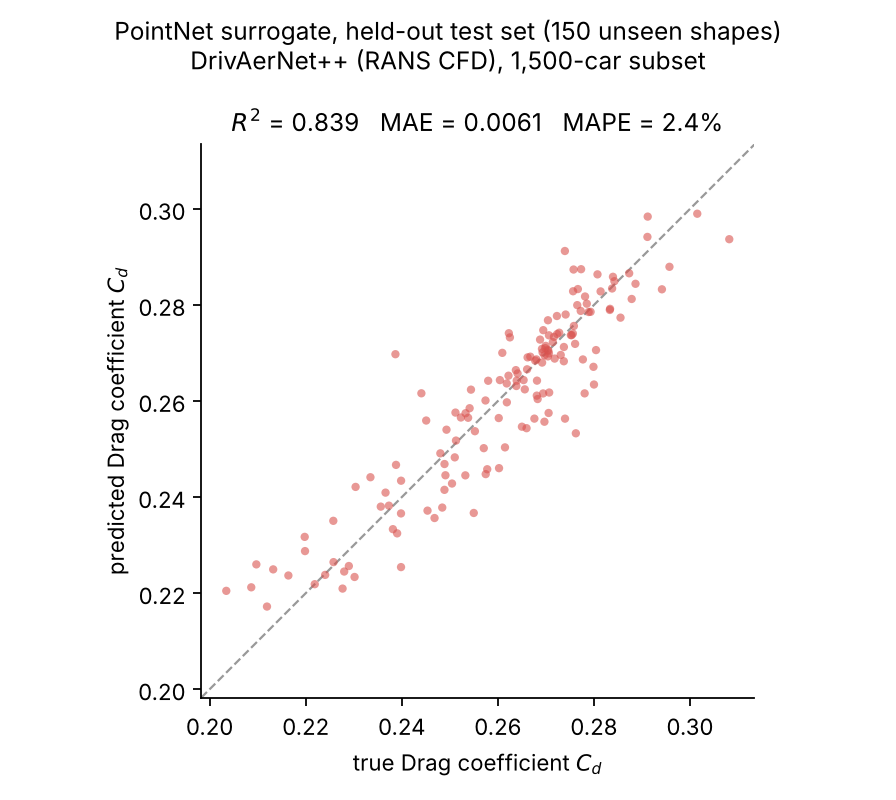

# AeroSurrogate

Drop a car's `.stl` into a web app and get its drag coefficient in well under a second.
A PointNet deep-learning model, trained on 1,200 car designs from the **DrivAerNet++** RANS CFD
dataset, stands in for a CFD run. On 150 cars it never saw, it predicts Cd with **R² 0.84** and a
**mean error of 2.4%** (MAE 0.0061, i.e. about 6 drag counts).



## How it works

1. **Geometry to point cloud.** `trimesh` loads the STL. The body is auto-oriented (longest axis is
   the flow direction, shortest axis is up), put on the ground plane, scaled to unit length and
   sampled into 1,024 surface points with their normals.
2. **PointNet regressor** (PyTorch). A shared per-point MLP (6 → 64 → 128 → 256 channels), then
   max- and mean-pooling into a global shape vector, then an MLP head that outputs `[Cd, Cl]`.
   The current weights are trained on drag only (DrivAerNet++ publishes drag for all 8k cars), so
   the app hides the lift output.
3. **Physics around the model.** The app measures the frontal area from the mesh, so it can turn
   the coefficients into drag force and drag power at any speed
   (`F = ½ ρ V² C A`, ρ = 1.225 kg/m³).
4. **Gradio interface.** STL upload, units and orientation controls, an interactive 3D view
   (Plotly), result cards, and a force-vs-speed chart.

## Training data

**DrivAerNet++** (Elrefaie et al., NeurIPS 2024, CC BY-NC 4.0): 8,000+ parametric variants of the
DrivAer car (fastback, estateback and notchback bodies, smooth or detailed underbody, several wheel
variants), each with a drag coefficient from a RANS CFD simulation.

- **Subset used:** 1,500 cars, sampled in proportion from all 8 body/underbody/wheel families.
  The full STLs are about 76 MB each, so `training/fetch_drivaernet.py` streams them one at a
  time from the Hugging Face mirror of the dataset, samples 4,096 surface points with normals and
  deletes the mesh. The whole subset costs about 2.5 hours on a 4-core CPU and 9 MB on disk.
- **Split:** 1,200 train / 150 validation / 150 test, random by design.
- **Drag range:** Cd 0.20 to 0.31 (std 0.020). The cars are variations of one baseline, so this
  is a fine-grained task: the model has to resolve differences of a few percent.
- The STLs in DrivAerNet++ are wound inside out (normals point into the car). The loader detects
  that from the signed volume and flips them, so normals are always outward.

## Results (DrivAerNet++ held-out test set, 150 cars)

| Target | R² | MAE | RMSE | Mean abs. % error |
|---|---|---|---|---|
| Drag Cd | 0.839 | 0.0061 | 0.0081 | 2.4% |

120 epochs on CPU, about 22 minutes. Inference takes about 0.35 s for a 40k-triangle STL (about 20 s for
a full-resolution 1.5M-triangle DrivAerNet++ mesh, almost all of it reading the file).

Spot check in the app on six cars from outside the 1,500-car subset (the example STLs, decimated
to 40k triangles):

| Car | CFD Cd | Predicted | Error |
|---|---|---|---|
| Fastback, detailed underbody (F_D_WM_WW_3978) | 0.296 | 0.293 | -1.0% |
| Estateback (E_S_WW_WM_594) | 0.283 | 0.278 | -1.8% |
| Estateback (E_S_WWC_WM_461) | 0.277 | 0.272 | -2.0% |
| Notchback (N_S_WW_WM_203) | 0.278 | 0.265 | -4.7% |
| Fastback (F_S_WWC_WM_062) | 0.253 | 0.245 | -3.1% |
| Notchback (N_S_WWS_WM_022) | 0.234 | 0.242 | +3.5% |

An earlier version of this project was trained on synthetic shapes with empirical (non-CFD)
labels; `training/synth_cars.py` and `training/build_dataset.py` still generate that dataset,
and `examples/synthetic/` holds a few of those shapes. Those shapes are not DrivAer variants, so
the current model's numbers for them are extrapolation.

## Run it

```bash
pip install -r requirements.txt
python -m app.app                 # http://127.0.0.1:7860
```

Rebuild the model from DrivAerNet++ (about 3 hours on a 4-core CPU, no GPU needed). The drag CSV
`DrivAerNetPlusPlus_Cd_8k_Updated.csv` is linked from the
[DrivAerNet GitHub README](https://github.com/Mohamedelrefaie/DrivAerNet):

```bash
python -m training.fetch_drivaernet --cd-csv data/DrivAerNetPlusPlus_Cd_8k_Updated.csv --n 1500
python -m training.train --data data/drivaernet.npz --epochs 120 --dataset-name "DrivAerNet++ (RANS CFD), 1,500-car subset"
python -m training.plot_results                # -> reports/parity.png
```

If you already have the STLs locally, `python -m training.drivaernet --stl-dir ... --cd-csv ...`
converts them instead. The synthetic pipeline is still there:
`training.build_dataset`, then `training.train --data data/synth_cars.npz`.

## Project layout

```
app/app.py              Gradio UI. Imports only cfd_core.inference.Predictor
cfd_core/geometry.py    STL loading, orientation, frontal area, point sampling
cfd_core/model.py       PointNet regressor
cfd_core/inference.py   Predictor: STL -> Cd, Cl, frontal area, forces
training/               DrivAerNet++ fetch/convert, synthetic data, training, plots
weights/                trained checkpoint
examples/               held-out DrivAerNet++ cars (decimated) + synthetic shapes
```

The UI and the model code are separate on purpose: `app/` can be published while `cfd_core/`,
`training/` and `weights/` stay in a private package, as long as `Predictor` keeps its interface.

## Limitations

- Every training car is a variant of the DrivAer sedan. The model is accurate within that family
  and has no basis for SUVs, vans, trucks or race cars; treat those numbers as extrapolation.
- Drag only. DrivAerNet++ has lift in its full CFD fields, but not in the drag CSV used here.
- Trained on 1,500 of the 8,000 cars on a CPU. More data and a bigger point cloud should push
  R² higher.
- Assumes a car-like body with flow along its longest axis. The app warns when a shape's
  proportions fall outside the training range.
- The "± spread" in the app is how much the prediction moves when the surface is resampled. It
  is not a CFD uncertainty.
- The surface colouring is a simple frontal-exposure shading, not a predicted pressure field.

## Next steps

- Train on all 8,000 cars with 2,048+ points on a GPU, and add lift.
- Validate a few shapes against OpenFOAM.
- Predict the full surface pressure field (per-point output head) and colour the 3D view with it.
- Deploy to Hugging Face Spaces.

## Citation

Elrefaie, M., Morar, F., Dai, A., Ahmed, F. *DrivAerNet++: A Large-Scale Multimodal Car Dataset
with Computational Fluid Dynamics Simulations and Deep Learning Benchmarks.* NeurIPS 2024
Datasets and Benchmarks. Data licensed CC BY-NC 4.0, so this project is for non-commercial use.
